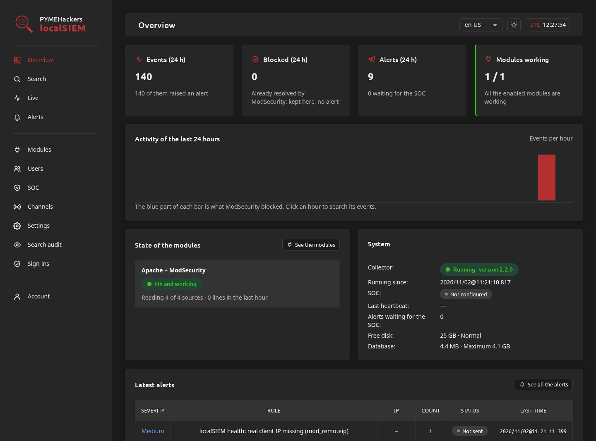

# localSIEM

Este README também está disponível em:\
[de-DE](README.de-DE.md), [en-GB](README.en-GB.md), [en-US](../README.md), [es-AR](README.es-AR.md), [es-ES](README.es-ES.md), [fr-FR](README.fr-FR.md), [he-IL](README.he-IL.md), [hi-IN](README.hi-IN.md), [it-IT](README.it-IT.md), [ja-JP](README.ja-JP.md), [ko-KR](README.ko-KR.md), [pt-BR](README.pt-BR.md), pt-PT, [ru-RU](README.ru-RU.md), [zh-CN](README.zh-CN.md)

## O que é

Um SIEM leve e modular que funciona no mesmo PC/servidor que protege. Alpine e Debian (para já).

## Módulos

Cada serviço do servidor é vigiado por um módulo, que ensina ao localSIEM onde estão os registos desse serviço, como lê-los e que regras se aplicam. Os módulos instalam-se, atualizam-se e desinstalam-se a partir da interface web, que os descarrega do repositório [localSIEM-modules](https://github.com/PYMEHackers/localSIEM-modules). Hoje existem dois:

- **apache2** (Apache + ModSecurity): junta o registo de acessos, o registo de erros e o registo de auditoria do ModSecurity de cada pedido.
- **privesc** (Escalada de privilégios): vigia o que é executado no servidor e avisa sobre os passos de uma escalada para root.

Um módulo nunca instala nada no servidor: se lhe faltar algo de que precisa, diz-lhe o que tem de instalar e fica desativado até que esteja lá.

## Capturas de ecrã



## Instalação

Execute-o como `root`.

**Debian 13**:

```bash
curl -fsSL -H 'Accept: application/vnd.github.raw+json' https://api.github.com/repos/PYMEHackers/localSIEM/contents/deploy/install-update-reinstall-debian.sh | bash -s -- --install --allow-from 203.0.113.10
```

**Alpine Linux 3.24**:

```bash
apk add bash curl && curl -fsSL -H 'Accept: application/vnd.github.raw+json' https://api.github.com/repos/PYMEHackers/localSIEM/contents/deploy/install-update-reinstall-alpine.sh | bash -s -- --install --allow-from 203.0.113.10
```

`--allow-from`: os IPs autorizados a abrir a interface web (`https://<server>:10443`).

## Consultar a documentação

Explore:

- [doc/MANUAL.pt-PT.md](MANUAL.pt-PT.md) para aprender a instalá-lo, configurá-lo e utilizá-lo.
- [doc/CODE.pt-PT.md](CODE.pt-PT.md) para perceber como está construído (para programadores e para modelos de IA).
- [localSIEM-modules](https://github.com/PYMEHackers/localSIEM-modules) para os módulos e a respetiva documentação.
